# ภาพหน้าจอระบบรับสมัครร้านค้า

แหล่ง: `https://sci.kku.ac.th/app/sciweekshop69/apply.php?event=event-2569-aa7ecc&round=12`

หมายเหตุ: รอบนี้สถานะจริงคือ **ปิดรับสมัครแล้ว** จึงบังคับเปิดแบบฟอร์มเพื่อถ่ายภาพเสนอที่ประชุม (ไม่ได้ส่งใบสมัครจริง)

## หน้าหลัก / สถานะรับสมัคร

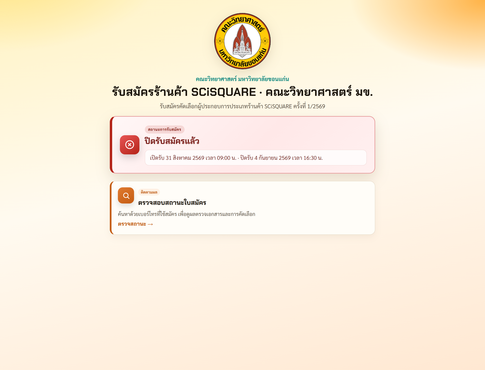

## ตรวจสอบสถานะใบสมัคร

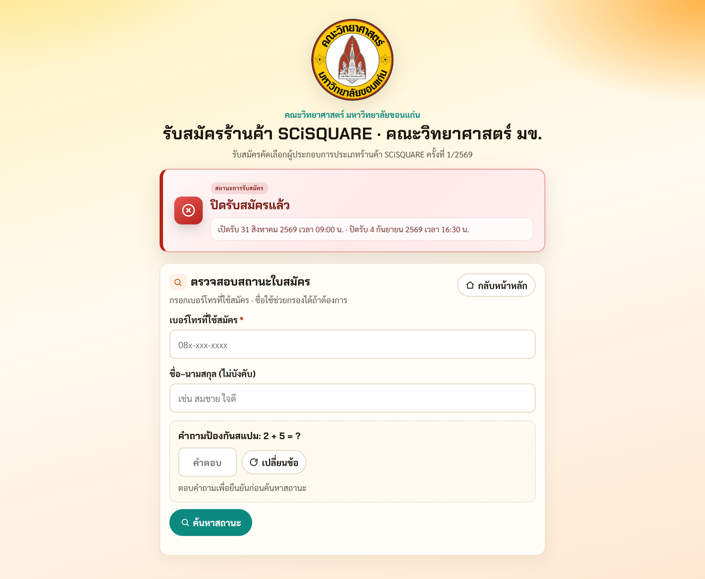

## ขั้นตอน 1 · ข้อมูลผู้สมัคร (ว่าง)

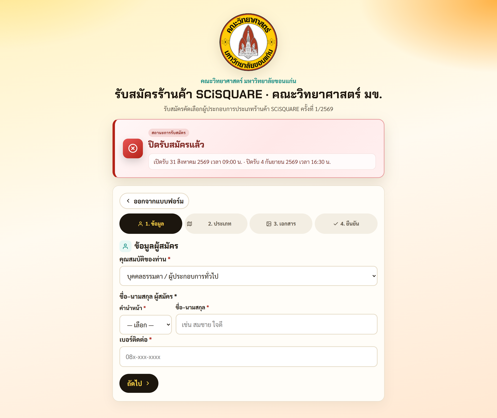

## ขั้นตอน 1 · ข้อมูลผู้สมัคร (ตัวอย่างกรอก)

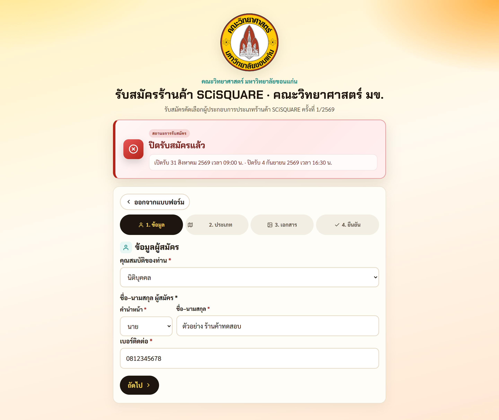

## ขั้นตอน 2 · เลือกโซนและประเภท

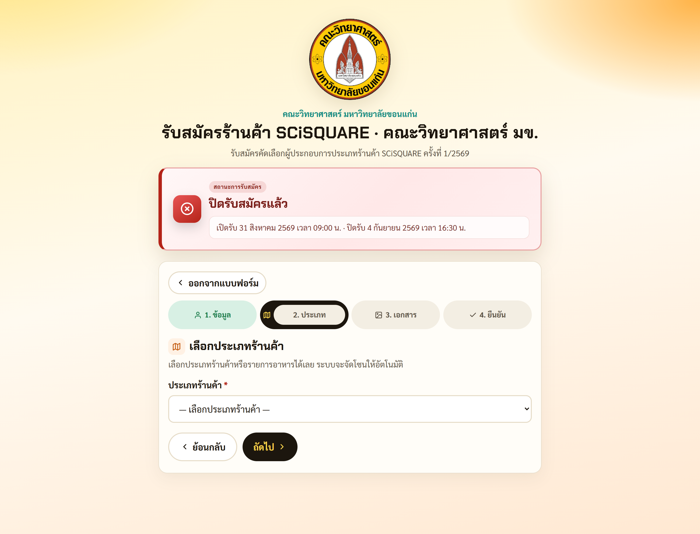

## ขั้นตอน 3 · อัปโหลดเอกสาร

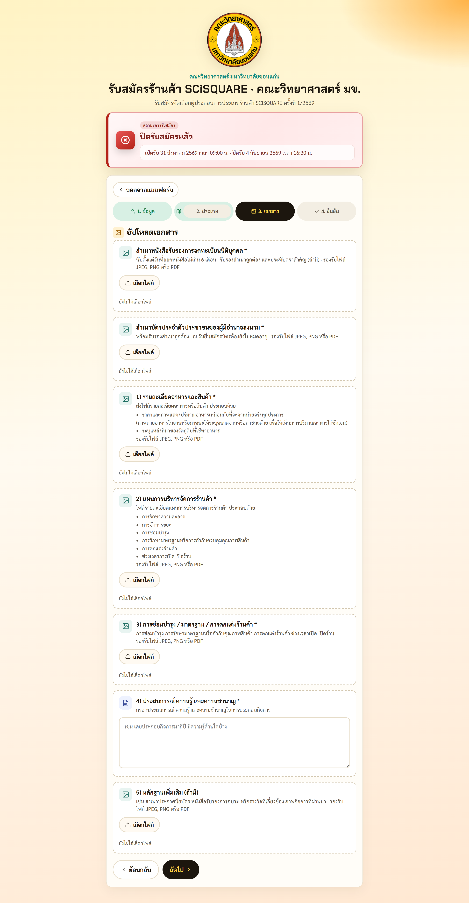

## ขั้นตอน 4 · ตรวจสอบก่อนส่ง

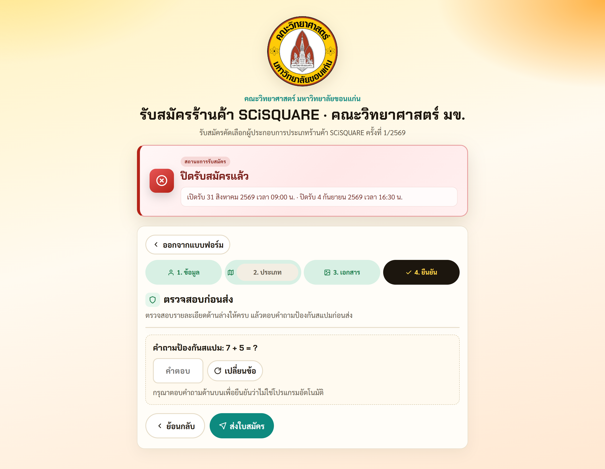

## มือถือ · หน้าหลัก

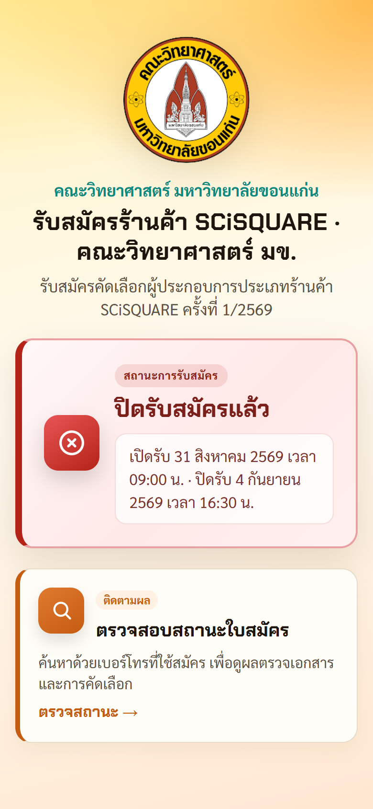

## มือถือ · ขั้นตอน 1

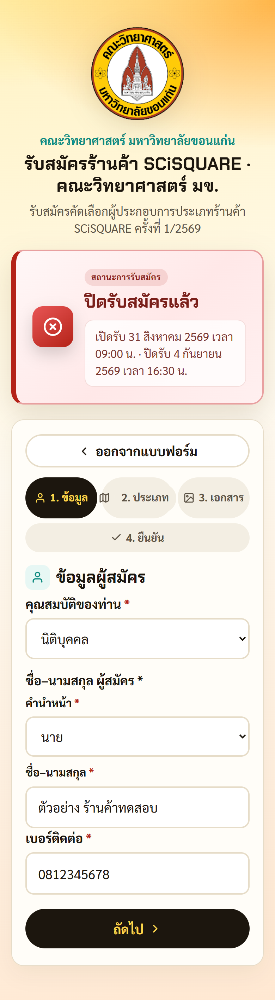

## มือถือ · ขั้นตอน 2

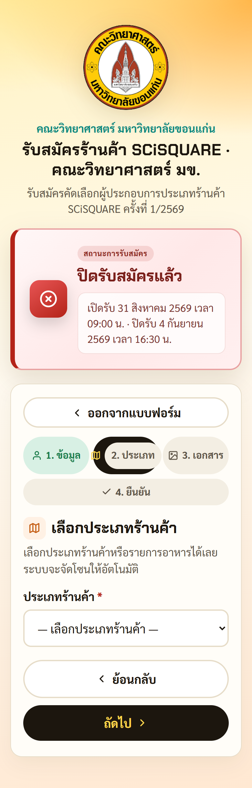

## มือถือ · ขั้นตอน 3

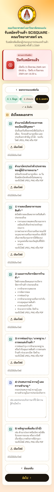
